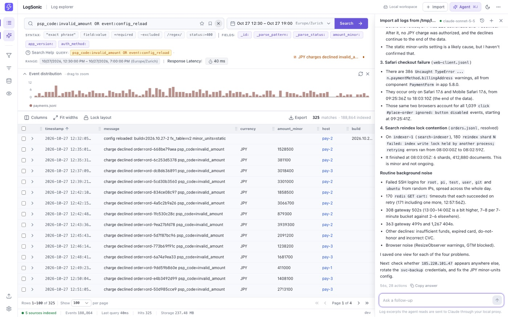

# LogSonic

> **Drop a log file or livestream one. Search it in seconds. Keep it fully offline. Let your AI agent query it.**

[](https://github.com/logsonic/logsonic/actions/workflows/ci.yml)
[](https://github.com/logsonic/logsonic/releases)
[](LICENSE)
[](https://github.com/logsonic/logsonic/stargazers)

LogSonic is a local-first log analytics app for Windows, Mac, and Linux. One self-contained binary serves a fast browser UI, auto-detects log formats, indexes everything for full-text search, and ships an MCP server so Claude, Cursor, Windsurf, or any MCP client can query your local logs. No telemetry and no cloud: import and search never leave your machine. The optional built-in agent talks only to the model endpoint you configure, which can be a model running on your own machine.


## New in v1.7.0

- **Redesigned import flow.** A single-surface import page replaces the old wizard, with async ingest jobs, live SSE progress, cancellation, and path-based preview for large files.
- **Sources catalog.** Manage imported sources from a Storage settings page — rename, re-import (without losing history or aliases), or delete a source, with per-day retention overrides.
- **Watched folders.** Point LogSonic at a folder and it ingests new files automatically, with a settings page and status-bar indicator.
- **Saved queries and query history**, plus a Fields panel for click-to-filter/exclude facets.
- **`logsonic open`** launches with pattern auto-detection and a bundled sample import for a zero-config first run.
- **Hardening and fixes.** Tighter CSP and Host-header allow-listing, JSON-only mutating routes, fixed double-decoding of search queries (`%` in queries), corrected sort order for rows sharing a timestamp, and a fix for facet scans hanging on a stuck cursor.

## Livestream

Stream logs into LogSonic while the browser is open. `logsonic tail` can follow a server-side file or read stdin, publish rows to the UI in real time, keep indexing in the background, and let you pause/resume the browser feed without stopping ingestion.

```bash
tail -f /var/log/app.log | logsonic tail - --source app
logsonic tail -f /var/log/app.log --source app
```

Rows are searchable immediately, including rows skipped while the browser feed was paused. See [Live Streaming](docs/live-streaming.md) or run the combined import + Livestream demo:

```bash
node demo/combined-demo.mjs
```

## Agent mode

Press **Cmd/Ctrl+J** (or the **Agent** button) to open the agent dock beside the log view. Describe the problem in plain language ("checkout started failing around 11:30, find out why") and the agent investigates the indexed logs with LogSonic's own tools. It shows each step as it works, and **Show in table** on any step puts that step's query, sources and time range into the table next to the dock.



### What the agent can do

| Tool | What it does |
|---|---|
| `ingest_local`, `ingest_remote`, `ingest_cloudwatch` | Import a local file or folder, a public HTTPS log file, or a CloudWatch log group (through your AWS CLI profile) |
| `list_sources`, `log_histogram` | See what is indexed, and when activity or errors spike, with exact counts per time bucket and source |
| `log_patterns` | **Full scan for rare events.** Reads every matching row (300,000 by default, up to 1,000,000) and groups messages into templates (`Failed password for <*> from <*>`), then lists the rarest templates, rare values of categorical fields (a single `psp_code=invalid_amount` among thousands of `authorised`) and fields that appear in only a few rows. This is how the agent finds problems hidden in INFO and WARN lines rather than only looking at ERROR rows. |
| `facet_logs`, `compare_windows` | Top values per field for a slice; an incident window compared with a baseline (totals, rates, level and source changes) |
| `query_logs`, `log_context` | Matching rows with exact totals; the rows just before and after a moment |
| `save_view` | Save a confirmed finding as a workspace with a fixed time window, so you can reopen exactly the evidence the agent used |
| `ui_*` | Drive the log view: set the query, time, sources and columns, sort, page, open panels |
| `mcp__<server>__<tool>` | Tools from external MCP servers you configure (see below) |

For an open-ended request ("something is wrong, find out what"), the agent orients with `list_sources` and `log_histogram`, sweeps with `log_patterns`, narrows with facets and window comparisons, confirms with rows, and then saves one view per confirmed problem. Each claim in the answer cites sources, times and counts, and the answer separates real problems from background noise that is present all day. A turn is bounded to 10 minutes, 24 model rounds and 60 tool calls.

We test this with a synthetic day of 188,864 log lines that hides an intrusion, a payment regression and a browser-specific UI bug among routine noise. The agent finds and pinpoints all three without being told what to look for. The generator and the scoring harness are in [`demo/agent-eval`](demo/agent-eval/README.md), and the results are recorded in [Agent validation](docs/agent-validation.md).

### Connect a model

The agent works with any server that speaks the Anthropic Messages API (`POST …/v1/messages`). The simplest way to connect one is **Settings > Agent** (the gear in the agent dock): pick Claude API, Ollama, LiteLLM or the local proxy, paste an API key if the endpoint needs one, choose the model, then **Test**. Once the endpoint URL is valid, the page lists the models it offers (Anthropic or OpenAI-style `/v1/models`, or Ollama's `/api/tags`); the download button next to **Model** opens that list and fills an empty field. LogSonic makes that request, sending a stored key only to the host it belongs to and never following redirects. These settings are saved in `agent.json` in the LogSonic storage folder, readable only by your user. A saved key is sent only to the endpoint host it was saved for, and the page never shows it again.

You can also use environment variables. They win over saved settings, and the settings page shows those fields as locked:

| Variable | Meaning | Default |
|---|---|---|
| `LOGSONIC_AGENT_PROXY_URL` | Full Messages endpoint. Plain `http://` is allowed only for `localhost`; remote endpoints must use `https://`. | `http://127.0.0.1:8789/v1/messages` |
| `LOGSONIC_AGENT_MODEL` | Model name sent with each request | `claude-sonnet-5-5` |
| `LOGSONIC_AGENT_PROXY_KEY` | Sent as `x-api-key`. For `https://api.anthropic.com` with no key set, `ANTHROPIC_API_KEY` is used; no other endpoint receives that key unless you set it here. | `local-proxy` |
| `LOGSONIC_AGENT_INGEST_ROOT` | Optional. Limits the agent's local imports to files inside this folder. Credential locations such as `~/.ssh`, `~/.aws` and `.env` files are always refused. | unset |

The dock header shows the model name when the endpoint answers, and a short fix-it message when it does not.

**Claude API (cloud):**

```bash
export LOGSONIC_AGENT_PROXY_URL=https://api.anthropic.com/v1/messages
export ANTHROPIC_API_KEY=sk-ant-...
export LOGSONIC_AGENT_MODEL=claude-sonnet-5-5   # or claude-opus-5-5
logsonic
```

**Local model with Ollama.** Ollama serves an [Anthropic-compatible API](https://docs.ollama.com/api/anthropic-compatibility) on port 11434; it ignores the key. Pick a model that supports tool calling.

```bash
ollama pull qwen3-coder
export LOGSONIC_AGENT_PROXY_URL=http://localhost:11434/v1/messages
export LOGSONIC_AGENT_MODEL=qwen3-coder
logsonic
```

**Other clouds and gateways (Amazon Bedrock, Google Vertex AI, Azure, OpenAI and others) through LiteLLM.** The [LiteLLM proxy](https://docs.litellm.ai/docs/anthropic_unified/) exposes `/v1/messages` in front of the providers it supports, so LogSonic talks to LiteLLM and LiteLLM talks to your provider with your provider credentials:

```yaml
# litellm.yaml
model_list:
  - model_name: logs-agent
    litellm_params:
      model: bedrock/<your Bedrock model id>   # or vertex_ai/..., azure/..., openai/...
```

```bash
litellm --config litellm.yaml               # listens on port 4000
export LOGSONIC_AGENT_PROXY_URL=http://127.0.0.1:4000/v1/messages
export LOGSONIC_AGENT_MODEL=logs-agent
export LOGSONIC_AGENT_PROXY_KEY=<your LiteLLM key, if you set one>
logsonic
```

**A gateway on another host** (a company LLM gateway, for example) works the same way as long as it uses HTTPS: `LOGSONIC_AGENT_PROXY_URL=https://llm-gateway.example.com/anthropic/v1/messages`.

The agent was developed and evaluated with Claude models. Smaller local models can call the tools but usually miss more of the subtle problems; the eval harness above is a quick way to compare models on your machine.

### Use other MCP servers from the agent

The agent can also call tools from other MCP servers: your ticket tracker, a filesystem with runbooks or on-call notes, a metrics or deploy history server. List them in `mcp.json` in the LogSonic storage folder (`~/Library/Application Support/Logsonic/mcp.json` on macOS, `%APPDATA%\Logsonic\mcp.json` on Windows, `~/.local/share/logsonic/mcp.json` on Linux, or under `-storage` if you set it; set `LOGSONIC_AGENT_MCP_CONFIG` to use another path). **Settings > Agent** shows the exact path, a command that opens it in your editor, an example, and each server's connection state, tools and errors after you click **Recheck**. The format is the one Claude Desktop and Claude Code use, so you can paste existing entries:

```json
{
  "mcpServers": {
    "notes": {
      "command": "npx",
      "args": ["-y", "@modelcontextprotocol/server-filesystem", "/Users/me/oncall-notes"],
      "tools": ["read_text_file", "list_directory", "search_files"]
    },
    "github": {
      "command": "npx",
      "args": ["-y", "@modelcontextprotocol/server-github"],
      "env": { "GITHUB_PERSONAL_ACCESS_TOKEN": "ghp_..." }
    },
    "tickets": {
      "type": "http",
      "url": "https://mcp.example.com/mcp",
      "headers": { "Authorization": "Bearer ..." }
    },
    "old-server": { "command": "old-mcp", "disabled": true }
  }
}
```

- **Transports:** `command` + `args` + `env` starts a local stdio server. `"type": "http"` with a `url` connects to a Streamable HTTP server, and `"type": "sse"` to an older SSE server. `headers` are sent with every HTTP request.
- **`tools`** limits which of a server's tools the agent may use. Use it for servers that can change things (create tickets, write files), and list only the read tools you want the agent to have. Without it, a server offering more than 64 tools exposes only the first 64 by name, and LogSonic logs a warning.
- **`disabled: true`** keeps an entry in the file without starting it.
- **Naming:** each tool appears to the model as `mcp__<server>__<tool>` (for example `mcp__notes__read_text_file`), and in the dock as `notes · read_text_file`.
- **When servers start:** LogSonic reads the file at each agent request and picks up edits without a restart. Servers connect in parallel. A server that fails to start is skipped and its error is recorded; the other servers keep working, and LogSonic tries the failed one again on a later request, at most once every 30 seconds. Stdio servers stop when LogSonic stops.
- **Check the setup:** `curl http://localhost:8080/api/v1/agent/mcp` connects the servers and lists each one with its transport, whether it is connected, its tool names and any error. The dock header shows the number of external tools after the first request. The status never shows `env` values, `headers`, arguments or URL paths, because those often hold tokens.

Example: with the `notes` server above, asking *"Check the on-call notes, then tell me which open ticket matches the JPY payment declines in payments.jsonl"* makes the agent read the notes through `mcp__notes__read_text_file`, query the logs, and answer with the ticket, the decline count and the first decline time.

### What leaves your machine

Agent mode is optional; import, search and the MCP server for external AI clients work without it. When you use it:

- Your prompts, the tool results and the log excerpts the agent reads are sent to the model endpoint you configured. With Ollama, or another model on your machine, nothing leaves the machine. With a cloud endpoint, do not use agent mode on logs you may not send to that provider; there is no redaction step.
- External MCP servers receive whatever arguments the model passes to their tools, which can include log excerpts. Stdio servers run as your user, with LogSonic's environment minus model credentials (`LOGSONIC_AGENT_*`, `ANTHROPIC_API_KEY`, `ANTHROPIC_AUTH_TOKEN`), plus the `env` you list. Only add servers you trust, and restrict servers that can change things with `tools`.
- Servers can only be added by editing `mcp.json` on disk. There is no API that adds one, so a web page or a log line cannot make LogSonic start a program.
- The agent treats log text as untrusted data. It is told to call external tools only when your request needs them, never because log content asks for it. That is an instruction to the model, not a sandbox, which is another reason to keep the `tools` lists tight.
- The agent's local imports refuse credential locations (`~/.ssh`, `~/.aws`, `.env` files and similar). Set `LOGSONIC_AGENT_INGEST_ROOT` to limit them to one folder.
- Agent endpoints accept requests from the local machine only. Investigations are saved in your browser's local storage.

More detail: [Agent mode](docs/agent-mode.md) and [Configuration](docs/configuration.md).

## Installation

Install on macOS with Homebrew:

```bash
brew tap logsonic/logsonic
brew install logsonic
open -a Logsonic
```

Homebrew installs the signed and notarized native app into `/Applications` and also adds the `logsonic` CLI to your path. After installation, you can launch the app from Applications, Spotlight, Launchpad, or Finder. Use `logsonic -open` when you specifically want the browser-based CLI experience.

Upgrade an existing installation with:

```bash
brew update
brew upgrade logsonic
```

Or download a pre-built binary from [GitHub Releases](https://github.com/logsonic/logsonic/releases), then open the URL printed by the server, usually:

```text
http://localhost:8080
```

For Linux, Windows, Docker, source builds, storage locations, and the macOS app behavior, see [Installation](docs/installation.md).

## Who It's For

- Engineers who cannot send logs to cloud tools.
- AI-native developers who want local logs available to MCP clients.
- Backend and SRE teams debugging large log dumps without standing up ELK.

## Why LogSonic

| | **LogSonic** | lnav | Logdy | GoAccess | Datadog/ELK |
|---|:---:|:---:|:---:|:---:|:---:|
| Fully offline / local-first | yes | yes | yes | yes | no |
| Browser GUI | yes | terminal | yes | HTML report | yes |
| Auto-detect log formats | yes | partial | no | web logs only | yes |
| AI agent access (MCP) | yes | no | no | no | partial |
| Indexed full-text search | yes | yes | no | no | yes |
| Single binary, no deps | yes | yes | yes | yes | no |
| Live tail / streaming | yes | yes | yes | yes | yes |

## Features

- Native macOS app with an embedded UI, automatic port selection, browser fallback, server logs, and graceful shutdown.
- Format detection with [log2grok](https://github.com/logsonic/log2grok), including custom saved Grok patterns.
- Multi-file import with per-file format confirmation.
- Smart timestamp resolution for logs with missing years, timezones, or dates.
- Bleve-backed full-text search with field shorthand, regex, exclusions, boolean operators, bounded pagination, and responsive rendering for large result sets.
- Live tailing from stdin or server-side files.
- MCP server for AI clients.
- Built-in investigation agent with full-scan rare-pattern search, saved views, and support for local or cloud models and external MCP servers.
- Saved local workspaces for recurring investigations.
- Color rules, event histogram, source filters, and dark/light themes.
- Local file-based storage with retention controls.
- `logsonic open app.log` from any terminal imports a file into the running app (starting it if needed) and prints the link to it.

## Documentation

- [Installation](docs/installation.md): Homebrew, app bundle, binaries, Docker, source builds, and storage paths.
- [Configuration](docs/configuration.md): command flags, environment variables, CLI subcommands, and examples.
- [Getting Started](docs/getting-started.md): importing logs, searching, and MCP setup links.
- [Live Streaming](docs/live-streaming.md): `logsonic tail`, stdin streaming, server-side file following, and demos.
- [Timestamp Resolution](docs/timestamp-resolution.md): how LogSonic derives real timestamps and when to override.
- [Development](docs/development.md): local backend/frontend setup, tests, E2E, and Swagger generation.
- [Architecture](docs/System_Architecture.md): backend, frontend, storage, ingest, search, and MCP architecture.
- [Roadmap](ROADMAP.md): the desktop-first principles, what is planned for the next releases, and what is deliberately out of scope.
- [MCP Setup](mcp/README.md): configure Claude Desktop, Cursor, Windsurf, or another MCP client.
- [Agent Playbook](mcp/SKILLS.md): query patterns and workflow guidance for AI clients.

## FAQ

**How does LogSonic handle large log files?**

It indexes logs with Bleve and stores local file-based indices for fast search over large datasets.

**Can I use custom log formats?**

Yes. Paste a Grok pattern during import or save custom patterns for reuse.

**Is my data sent to any servers?**

Not by import, search or the MCP server: LogSonic runs locally and keeps data on your machine. The optional agent mode sends prompts and the log excerpts it reads to the model endpoint you configure, and tool arguments to any external MCP servers you add. Point it at a local model to keep everything on your machine. See [What leaves your machine](#what-leaves-your-machine).

## Support

For issues, feature requests, or questions, open an issue on the [GitHub repository](https://github.com/logsonic/logsonic/issues).

## License

LogSonic is released under the [MIT License](LICENSE).
